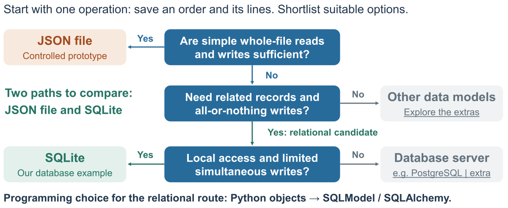

# Station Bar API

A waiter records an order for two coffees at table 3. The bar needs to remember the order and prevent changes once it is ready. Follow that one scenario from an HTTP request through validation, business rules and storage.

The backend uses [FastAPI](https://fastapi.tiangolo.com/tutorial/first-steps/). For the framework features used in the exercise, see the [official documentation links beside the starter walkthrough](starter/README.md#official-fastapi-documentation).

This repository is a running teaching reference used across several classes. The numbered exercises follow the same bar example from its API contract to implementation, validation and persistence. No SQL or ORM knowledge is required.

## Choose the version: JSON files or SQLite

| Version / folder | Where data is saved | Use it for | API port |
| --- | --- | --- | --- |
| **[Complete JSON solution](solution/README.md)** ? `solution/` | `solution/data.json` | The working menu/order backend; Exercise 4 opening demo and explanation (Parts A?B). | **8000** |
| **[JSON exercise starter](starter/README.md)** ? `starter/` | `starter/data.json` | The earlier exercise: complete the order endpoint in Exercise 2. | **8001** |
| **[SQLite / ORM comparison](extensions/orm/README.md)** ? `extensions/orm/` | `extensions/orm/data/bar.sqlite` | The smaller database example and query experiment (Parts D?E). | **8002** |

The two JSON versions load and save a file directly. The ORM example uses SQLModel/SQLAlchemy to work with rows in SQLite. **All three APIs send and receive JSON over HTTP**; the distinction above is how they store data.

Each version has separate saved data. The SQLite example is an optional comparison, with its own setup and a smaller set of endpoints. The complete JSON solution remains available for your project.

## Current class: Persistence and databases (Exercise 4)

Last class, we followed an order through the API and its business rules. This class asks **where that order is kept, what survives stopping the application, and when a database helps**.

We start with a **lecturer demonstration** of the existing JSON solution. Then we explain storage choices and related records, read the ORM code together, and finally run the comparison and change one query. No SQL knowledge or local installation is required. Using an ORM in your project remains optional.

**Begin with [Exercise 4, Part A: watch and predict](exercises/04-persistence.md#part-a---observe-json-persistence).** Follow the [A-E classroom stages](#where-to-work-in-this-lesson) with the lecturer. Open the [storage decision guide](docs/storage-choice.md) when we discuss the options in Part B.

**Reopening a Codespace? Check for teaching updates first.** Follow the [check, fetch and update guide](docs/updating-your-codespace.md) to keep your work and get the new material. Reopening alone does not pull changes; the startup terminal reminder helps you remember. New to this repository? See [Open in GitHub Codespaces](#open-in-github-codespaces); setup for the ORM example comes later, in Part D.

## Start here

**Follow the learning path:** [1. Contract](exercises/01-api-contract.md) → [Code map](docs/code-map.md) → [2. Endpoint](exercises/02-create-order.md) → [3. Validation and rules](exercises/03-validation-and-rules.md) → [4. Persistence and databases](exercises/04-persistence.md).

Use the **Previous / Next** links at the top and bottom of each guide to move between steps. **Learning path** brings you back here.

| Exercise | What you practise |
| --- | --- |
| [1 — Read the API contract](exercises/01-api-contract.md) | Identify the operation, required input, successful response and possible errors. |
| [2 — Implement an order endpoint](exercises/02-create-order.md) | Complete `POST /orders` in the starter and check its behaviour. |
| [3 — Validation and business rules](exercises/03-validation-and-rules.md) | Try successful and rejected requests; explain which layer decides. |
| [4 — Persistence and databases](exercises/04-persistence.md) | Check restart persistence, map the same records to related tables, and explore an optional ORM setup. |

### Where to work in this lesson

[Exercise 4 classroom quick start](exercises/04-persistence.md#classroom-quick-start): where to open, which function to read or edit, commands and checks.

**Watch the opening demo. Then follow each part with the lecturer.** At the end of a student activity, stop where its instructions indicate and join the debrief before starting the next part.

| Part / block | Open | Start and stop |
| --- | --- | --- |
| A / 1: opening demonstration | [Observe JSON persistence](exercises/04-persistence.md#part-a---observe-json-persistence) | Watch the lecturer create/restart/retrieve. Stop after the prediction and observation; no student setup yet. |
| B / 1: explanation | [Explain JSON storage](exercises/04-persistence.md#part-b---explain-json-storage) | Follow storage choices and seed/load/change/save. Stop when you can explain the observed result. |
| C / 2: related records | [Relational sketch](exercises/04-persistence.md#part-c---sketch-related-records) | After keys/relationships, sketch the extra line and response. Pause for the debrief. |
| D / 3: ORM walkthrough | [Classroom stages in the ORM guide](extensions/orm/README.md#classroom-stages) | Read the code first; then run on 8002 when introduced. Stop after the guided success/rejection checks. |
| E / 4: query and project | [Change one query](exercises/04-persistence.md#part-e---change-one-query) | Predict/change/check `list_menu`; pause for the answer, then justify storage for one project operation. |

Use the [version comparison above](#choose-the-version-json-files-or-sqlite) to match the folder and port to the current part. Start the ORM setup only when we reach Part D.

**Revisit the previous class:** `starter/` on port **8001** remains the focused order-creation exercise. [Exercise 2](exercises/02-create-order.md), [validation and rules](exercises/03-validation-and-rules.md), the [Python refresher](starter/README.md#python-refresher) and the [code map](docs/code-map.md) remain available. Edit `starter/` when returning to Exercise 2; today's query experiment is in `extensions/orm/main.py`.

For the next project steps, use the [FastAPI reading guide](exercises/04-persistence.md#fastapi-reading-for-the-next-steps): route organisation, tests, frontend integration, security and deployment. Read selectively as those topics enter the course.

## Storage decision guide

The same diagram appears in the slides. Use it to shortlist storage for **one project operation**, then explain the requirement behind your choice.

[](docs/storage-choice.md)

[Read the diagram and its sources](docs/storage-choice.md). JSON files and SQLite are the two paths demonstrated here; the other branches are further reading. SQLModel/SQLAlchemy describes how we program with mapped objects, separately from the storage choice.

## From exercises to the complete application

We will use this repository throughout the bar exercises, extending the same application in later persistence and frontend-integration classes. The exercise guides and starter will remain available for practice and revision.

At the end of the sequence, a **clean reference download of the finished application** is planned. It will contain the complete application, setup instructions and tests, without the unfinished starter or exercise guides. It will come from the same maintained implementation in this repository.

That final download is not available yet. The current `solution/` is the completed backend for this stage; the integrated frontend and later course additions are still to come.

## Open in GitHub Codespaces

**No local installation is required for this class.** You only need a browser and your GitHub account with Codespaces access. Each student (or pair) works in their own Codespace, which provides VS Code, Python and the JSON example dependencies in the browser. The optional ORM example has its own setup inside that Codespace. You do not need to install Python, VS Code or Docker on your computer.

Use the repository link shared for class, not the lecturer's Codespace or forwarded-port URL. GitHub clones the project into your new Codespace automatically: a local clone is not required. If you want your own repository for saving changes, fork the shared repository first and create the Codespace from your fork.

1. Sign in to your own GitHub account and open the repository shared for this class (or your fork).
2. Choose **Code > Codespaces**, then create **your own Codespace** or resume one you previously created. Wait for environment creation and dependency installation to finish.
3. In the Codespace terminal, from the repository root, run:

```sh
python run.py solution --host 0.0.0.0
```

4. In **Ports**, open port **8000** in your browser and add **/docs** to the forwarded address. Keep port visibility **Private**.

**For the SQLite / ORM example on port8002, use its [separate environment setup and launch commands](extensions/orm/README.md#start-the-orm-example-in-part-d).** The default Python above contains the JSON example dependencies; it does not prepare the ORM environment.

This opens the complete **solution**. Use the forwarded address from Codespaces; localhost on your laptop is a different location. [Codespaces guide](docs/codespaces.md).

In Swagger UI, open **GET /menu-items/{menu_item_id}**, select **Try it out**, enter `1`, and execute. Then open **POST /orders** and send:

```json
{"table": 3, "items": [{"menu_item_id": 1, "quantity": 2}]}
```

Expect `201`, a pending order and a `Location` header. Follow the returned ID with **GET /orders/{order_id}**. Use the ID in your response; it changes as orders are added.

Stop an API with Ctrl+C. The JSON starter and solution each save their own `data.json` in the Codespace; the optional ORM example saves a separate SQLite file. See [Codespaces controls and reset](docs/codespaces.md).

## Earlier lesson: work on the starter

Open [exercise 2](exercises/02-create-order.md) beside your editor and follow its steps. If it has been a while since you used Python, start with the [short Python refresher](starter/README.md#python-refresher). Run all commands from the repository root, where `run.py` and `check.py` are located.

The starter's `bar_api/api.py` contains only the setup, three short GET handlers and the marked POST handler. The supplied `errors.py` keeps error formatting outside this exercise file. Open `models.py`, `service.py` and `storage.py` when tracing those responsibilities; no changes to them are required for this task.

**Why two ports?** We run two versions of the backend side by side in the same Codespace:

- **8000 - complete reference (`solution/`):** inspect the expected behaviour.
- **8001 - your exercise (`starter/`):** try the code you are changing.

The port determines which running API receives your request. Starting both with these commands on port 8000 would cause an "address already in use" error. Separate ports let you keep both `/docs` pages open and compare results. You could reuse one port by stopping one API before starting the other; two ports simply make comparison easier.

Start the starter from a **new terminal** (**Terminal > New Terminal**); leave the reference API running in its own terminal:

```sh
python run.py starter --host 0.0.0.0 --port 8001 --reload
```

Open port **8001** from **Ports**, then add **/docs**. Edit [starter/bar_api/api.py](starter/bar_api/api.py) in your editor; Python changes reload automatically. The solution on port 8000 remains available for comparison and has separate data.

Valid order creation initially returns **501**: that is the function you complete. The three GET handlers and validation are provided. Follow [exercise 2](exercises/02-create-order.md).

Use another free terminal to run checks against **your starter**. The checks do not need a running API:

```sh
python check.py starter
```

Initially two checks pass and two fail. After implementing the handler, all four should pass. Checks use temporary data, not your saved demonstration orders.

Save your changes, then stop the codespace when you finish. Closing its browser tab does not stop the compute session.

## Later: local execution and external clients

In the design and deployment classes, we will revisit how to run and connect to the same application:

- **Run it locally:** clone or download the repository and follow [local Python setup](docs/python-setup.md). This is an alternative for later, not preparation required for this exercise.
- **Connect Postman or a frontend:** use the local API address or a forwarded Codespaces URL. We will demonstrate changing port visibility to **Public** for external access; see [later connection options](docs/codespaces.md#later-postman-and-frontend-connections). A public port is accessible to anyone with its URL. Keep your ports **Private** for the current exercise.
- **Explore containers:** [container setup](docs/containers.md) is optional material for later. Docker installation is not part of this class.

## What is supplied

- [solution/](solution/README.md): complete menu/order CRUD, business rules, JSON storage and reference tests.
- [starter/](starter/README.md): focused create/read exercise; complete the marked order-creation handler.
- [extensions/orm/](extensions/orm/README.md): five-route SQLite/ORM comparison, including a query experiment and database tests.
- [Code map](docs/code-map.md): responsibilities and the Spring comparison.
- [Demonstration walkthrough](docs/demo-walkthrough.md): a longer sequence of requests.
- [Postman collection](bar-api.postman_collection.json): supplied for later calls to the local API or a forwarded Codespaces URL. For this exercise, use the signed-in browser and `/docs`; see [later connection options](docs/codespaces.md#later-postman-and-frontend-connections).
- [Teaching contract](solution/contracts/bar-api.published-v0.2.0.json) and [generated contract](solution/contracts/bar-api.generated.json). The live contract is at `/openapi.json`.

The repository covers HTTP, application logic, JSON persistence and a separate relational/ORM comparison. Frontend integration and authentication remain later stages. The Spring Boot/Java and PostgREST comparisons in the slides are optional reading; runnable versions are not supplied here.

The dependency files separate the three main application packages from test tools and the recorded environment snapshot. See [why there are several requirements files](starter/README.md#why-are-there-several-requirements-files). Codespaces prepares the JSON example packages. The ORM guide installs its dependencies in a separate environment inside the Codespace; the earlier examples keep theirs.

## Scope and checks

For the current exercise, use this unauthenticated example in your private development environment, with one server process per data file. In the complete reference, `PUT` replaces editable fields; status transitions and `PATCH` are not included.

`python check.py starter` runs the four focused exercise checks. `python check.py solution --full` runs the full reference CRUD suite; those extra operations are outside the starter. The older plain `pytest` command at the repository root checks only the supplied solution.

The Codespaces configuration is prepared; hosted build/startup and private forwarded-port access still need rehearsal before classroom delivery. The Python backend and exercise checks have a separate local verification record.

Sources: [Creating your own Codespace](https://docs.github.com/en/codespaces/developing-in-a-codespace/creating-a-codespace-for-a-repository), [GitHub Codespaces quickstart](https://docs.github.com/en/codespaces/quickstart) and [forwarded ports](https://docs.github.com/en/codespaces/developing-in-a-codespace/forwarding-ports-in-your-codespace).
