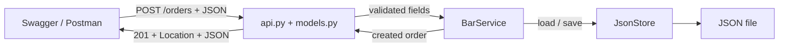

# Follow an order through the code

[← Previous: API contract](../exercises/01-api-contract.md) | [Learning path](../README.md#start-here) | [Next: implement the endpoint →](../exercises/02-create-order.md)

The waiter records an order for two coffees at table 3. Start with the focused `starter/` files below. The complete `solution/` adds the remaining menu/order CRUD operations. For a reminder of functions, dictionaries and type hints, use the [Python refresher](../starter/README.md#python-refresher) before tracing the handlers.

| File in starter/ | Question it answers | In this exercise |
| --- | --- | --- |
| main.py | How is the application started? | Creates the app with its data-file location |
| bar_api/models.py | What can the request contain? | Positive quantity; required table and items |
| bar_api/api.py | How does HTTP reach the application? | Route, request parsing, service call, status and Location |
| bar_api/service.py | Is the action allowed, and what happens? | BarService checks item availability, assigns an ID and creates the order |
| bar_api/storage.py | How is state retained? | JsonStore loads and saves the data file |

`bar_api/errors.py` is supplied support for formatting HTTP errors; no edits are needed for the exercise. The starter has no menu-write or order-update/delete code.

Find `create_order` in api.py and service.py. Their names refer to the same operation, but their responsibilities differ. The route handles HTTP; the service handles application rules.

**Predict before running:** quantity 0 is rejected by the input model; unavailable item 3 is rejected by the service after parsing succeeds. Both produce 422, so status alone does not tell you which layer made the decision.

## Connection to Java / Spring

| Responsibility | This FastAPI implementation | Internet Technology examples |
| --- | --- | --- |
| HTTP interface | Route functions and decorators | Controller classes and mapping annotations |
| Application rules | BarService class | MenuService class |
| Persistence | JsonStore class, loading/saving a whole snapshot | PizzaRepository interface backed by JPA |
| API data shapes | Pydantic input/output classes | Request/response objects; persistence entities have a separate purpose |

These are comparable responsibilities, not identical framework features. Pydantic models are not database entities, and JsonStore is not a JPA repository. Replacing file storage later also requires deciding where record lookup and transactions belong.

---

[← Previous: API contract](../exercises/01-api-contract.md) | [Learning path](../README.md#start-here) | [Next: implement the endpoint →](../exercises/02-create-order.md)
