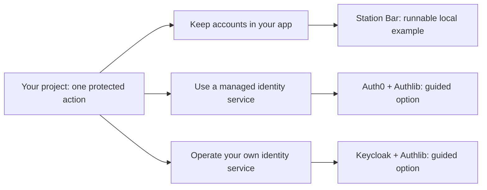
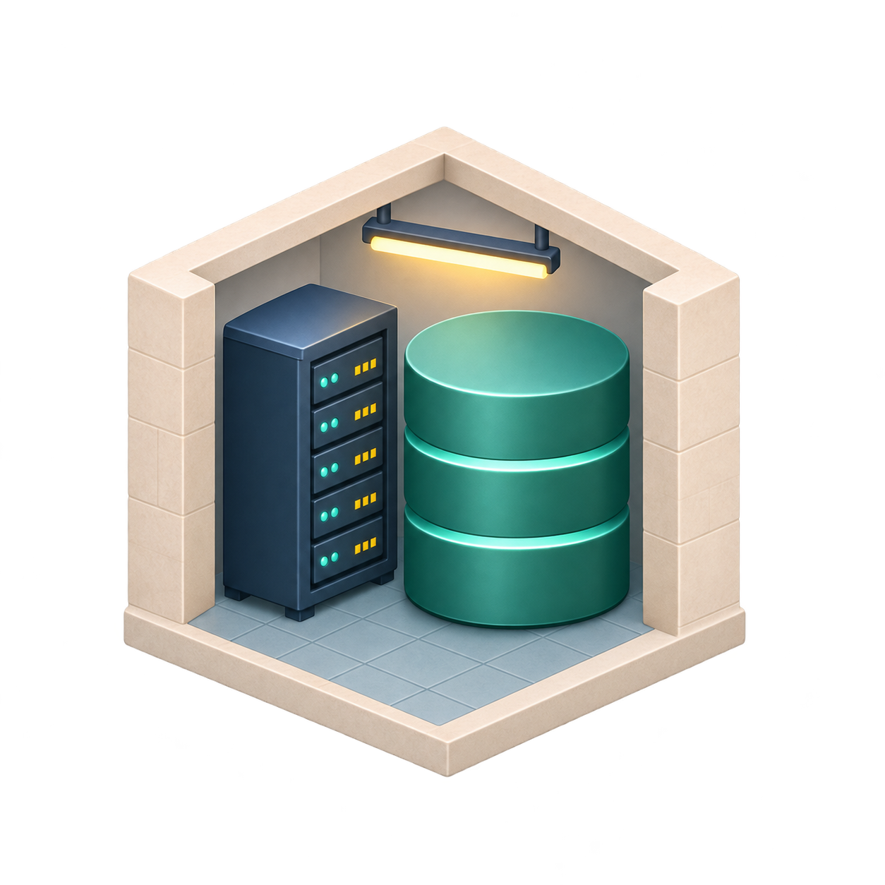
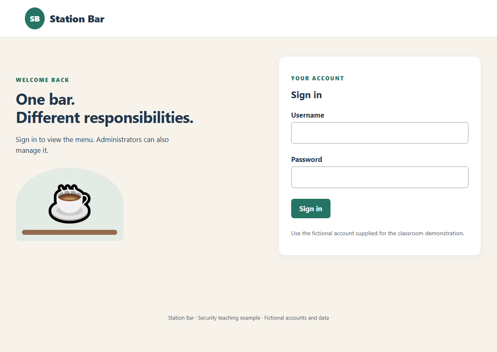
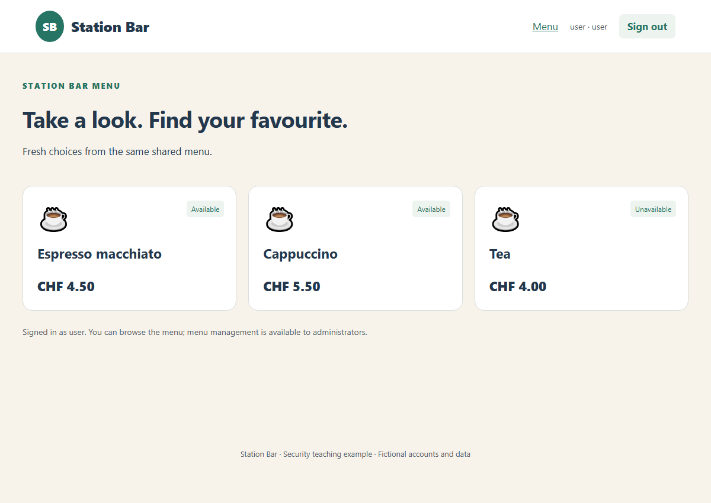
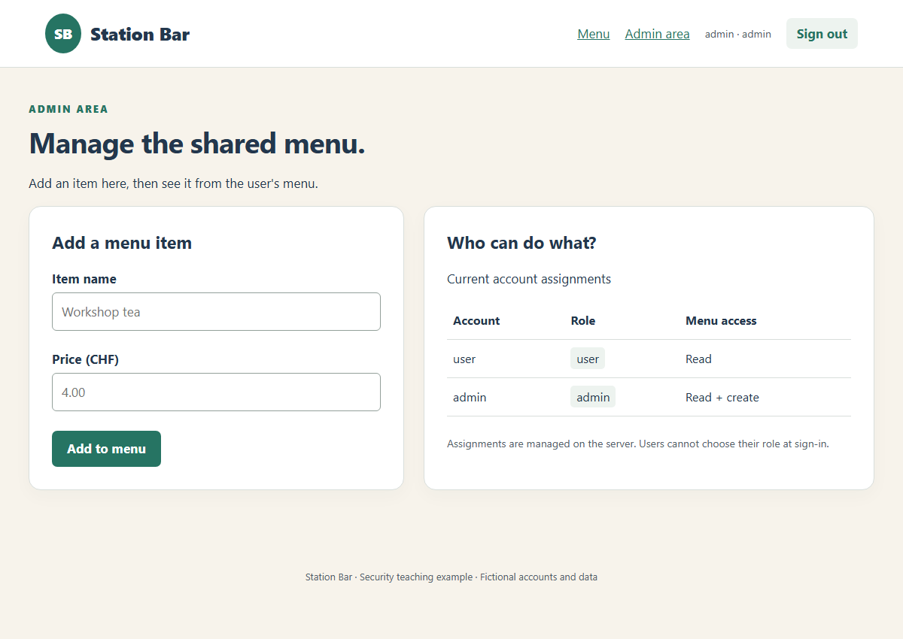
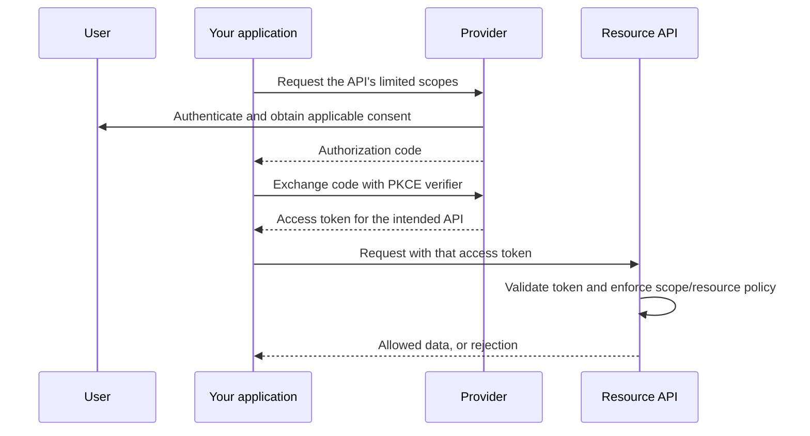

# Add login and a protected action to your FastAPI project

[Run the example first](../../extensions/security/README.md) · [Exercise 6](../../exercises/06-security.md)

Start from your working application. Choose one route below, keeping the same template → route → service → saved data path used in the frontend class. Steps 1–7 follow Station Bar's **Jinja pages and server-side sessions**. The provider options offer separate configuration paths for FastAPI/Jinja; a separate JavaScript frontend needs the provider's corresponding SPA integration.

<a id="login-options"></a>

## Choose who manages sign-in



| Choose this when… | Start here | What you configure | Current status |
|---|---|---|---|
| You want to understand or reuse local login | [Station Bar steps 1–7](#try-the-roles), slides A2–A18 | Trusted accounts, session and one permission policy | Implemented and locally tested in this repository |
| You want a provider to handle sign-in | [Auth0 route](#auth0), slide A21 | Provider application, redirects, Authlib and local account mapping | Optional configuration guide; no provider is registered by the class launcher |
| You want to operate that provider yourself | [Keycloak route](#keycloak), slide A22 | Identity service, app realm/client, test users, redirects and Authlib | Optional configuration guide; additional service to run and verify |

These are alternatives, not three tasks. Retain a working project login if it fits your needs. In every route, your application enforces permissions on its protected operations. An external login does not make someone an admin. The provider routes have **not** been exercised end to end in this repository or its Codespace.

**Login or delegated API access?** OIDC sign-in tells the app who authenticated. OAuth access to another API additionally needs the intended API and its scopes, for example permission to read a user's calendar. See [delegated access](#delegated-api-access). The provider choices below primarily guide sign-in.

<!-- login-route:start -->

**Your route through the example**

<table>
<tr>
<td align="center" width="25%"><a href="#try-the-roles"><br><strong>1. Try the roles</strong></a><br>Annex A2–A5</td>
<td align="center" width="25%"><a href="#trace-the-checks"><br><strong>2. Trace the checks</strong></a><br>Annex A6–A13</td>
<td align="center" width="25%"><a href="#protect-your-action"><br><strong>3. Protect your action</strong></a><br>Annex A14–A16</td>
<td align="center" width="25%"><a href="#verify-the-result"><br><strong>4. Verify the result</strong></a><br>Annex A17–A18</td>
</tr>
</table>

The four stages match the **08A FastAPI Login and Permissions** slides. Start with the working example; use the later stages when adapting your project.

**Considering an external provider?** [Choose the Auth0 or Keycloak route](#login-options); optional guided configurations in A21–A22.

**Want to implement JWT access?** [Run the optional JWT practice](jwt-practice.md); same accounts and action, A23–A26.

<!-- login-route:end -->

<a id="try-the-roles"></a>

## 1. See the outcome before changing code

Run `python start_security.py`, open the printed **8003 `/login`** link, and open `.classroom/security-credentials.json` locally for the fictional `user` and `admin` passwords. Keep these out of screenshots and Git.



Sign in as **user**. You can browse the menu. Open `/admin` directly: the server returns **403**, even though you reached it without a button. Sign out, then sign in as **admin**. Open **Admin area**, add `Workshop tea` at `4.00`, and return to the menu. Sign out and sign in as user to see the same saved item. Use separate **browser profiles** to show both identities at once; ordinary tabs and windows in the same profile share the login cookie.

| User view | Admin view |
|---|---|
|  |  |

**Checkpoint:** explain why removing a button alone would not protect `/admin/menu-items`.

<a id="trace-the-checks"></a>

## 2. Define one policy using your own project

Write a small table before adding routes. The Station Bar uses:

| Role | Read the menu | Create an item |
|---|---|---|
| `user` | Yes | No |
| `admin` | Yes | Yes: `menu:write` |

See [`accounts.py`](../../extensions/security/accounts.py). `ROLE_PERMISSIONS` defines the permission belonging to each role. `Account.role` is assigned by the server. In this example, the first startup creates `.classroom/security-accounts.json` containing usernames, roles and password hashes. The separate credentials file is only for accessing the fictional classroom accounts.

The admin table **displays** assignments; it is not a role-editing screen. The small, reversible experiment in [step 6a](#6a-try-one-policy-change-in-station-bar) demonstrates where permission is enforced. In a real app, role assignment needs its own restricted administrative process. Never accept `role=admin` from a login or registration form.

## 3. Connect accounts and password verification

Use the pinned packages in [`requirements.txt`](../../extensions/security/requirements.txt) in your project's virtual environment. The provided launcher installs them in `.venv-security`; it does not alter the earlier examples.

Follow `AccountStore.authenticate()` in [`accounts.py`](../../extensions/security/accounts.py):

```python
password_hash = PasswordHash.recommended()
stored_hash = password_hash.hash(password)       # when creating an account
valid = password_hash.verify(password, stored_hash)  # when signing in
```

These are the library operations to understand; use the complete account implementation, including the unknown-user case. When adapting your project, replace the fictional `AccountStore` lookup with your existing user repository (JSON or database). Keep password hashes in server-controlled storage. There is no need to change your storage technology merely to add this example.

**Checkpoint:** a wrong username/password produces the same sign-in error. Neither plaintext passwords nor stored hashes appear in the pages or API responses.

## 4. Keep login state and check the next request

Read [`sessions.py`](../../extensions/security/sessions.py), then `login()` and `browser_user()` in [`pages.py`](../../extensions/security/pages.py):

1. The login form submits username/password and a form token.
2. The server verifies the password, discards the previous session identifier and issues a new random one.
3. An **HttpOnly cookie** carries only that identifier. Roles and permissions stay on the server.
4. Each protected request resolves the session and loads the current account's permissions.

Browser sessions last one hour. Sign-out revokes the session on the server; restarting the example invalidates all sessions. Saved accounts and menu data remain.

Keep CSRF validation on login, logout and menu changes. The hidden form token is bound to the session and differs from the session cookie. `SameSite=Lax` is an additional control, not a replacement for the form-token check. Codespaces enables `Secure` cookies automatically; local loopback HTTP uses non-Secure cookies. For any other HTTPS deployment use the `--secure-cookies` option when running `extensions/security/run.py`.

For example, **one** `POST /admin/menu-items` submission carries two different values:

| Value in the request | What the server does with it |
|---|---|
| Session cookie, attached by the browser | Finds the account and checks `menu:write`. |
| Hidden `csrf` field, submitted with the form | Compares it with the token stored in that session. |

The server rendered the form token into the page. The browser does not turn the session cookie into a CSRF token. A valid login with an invalid form token is rejected; no item is saved. Item validation must also succeed before the service writes.

## 5. Put the permission check on the operation

The key functions are `browser_user()` → `can_manage_menu()` → `add_menu_item()` in [`pages.py`](../../extensions/security/pages.py):

```python
def can_manage_menu(user: BrowserUser):
    if "menu:write" not in user.permissions:
        raise HTTPException(403)
    return user

MenuAdmin = Annotated[Principal, Depends(can_manage_menu)]
```

Both the admin GET route and the write POST route declare `user: MenuAdmin`. The complete POST handler also checks CSRF, validates the HTML field values and only then calls the existing `BarService.create_menu_item()`.

For your own action, change the permission name, connect the appropriate service and protect **all routes that can perform that action**, including APIs. If access depends on ownership, add a trusted user-to-record relationship and check the particular record; a role check alone does not supply ownership.

<a id="protect-your-action"></a>

## 6. Add the pages without replacing your application

### 6a. Try one policy change in Station Bar

First make one small change in a **local branch or recoverable copy of the reference**, before transferring files into your own project. This is an optional learning step.

1. Start the example and confirm that `admin` can open `/admin`, while `user` receives **403**.
2. Open [`extensions/security/accounts.py`](../../extensions/security/accounts.py). In `ROLE_PERMISSIONS`, temporarily change only the admin entry:

   ```python
   # Original — restore this at the end:
   "admin": frozenset({"menu:write"}),

   # Temporary replacement — no permission:
   "admin": frozenset(),
   ```

   These are alternative entries inside the existing dictionary, not two entries to keep together. Do not change the permission dependency or the CSRF checks.
3. Stop this example with **Ctrl+C**, run `python start_security.py` again, reload `/login` and sign in as `admin`. Opening `/admin` directly now returns **403**. Authentication still works; the permission changed.
4. **Restore the original entry**, restart and sign in again. Check that admin access works and user access remains denied. Restore this before continuing, running the reference checks or publishing.

**Explain the result:** the server's permission mapping controls the operation; the username and the presence of a button do not grant access by themselves.

### 6b. Choose one action and separate what to keep from what to adapt

In a branch or recoverable copy of your own project, choose one existing business operation and fill in one row: **role → permission → protected route → existing service method**.

| Keep the security controls | Adapt the project connections |
|---|---|
| Library password hashing and verification | The trusted account lookup in your existing JSON/DB user store |
| Session creation, expiry, rotation and logout | Your users, server-assigned roles and permission names |
| CSRF validation and server-side permission checks | Your page/form names, validated input and business-service call |

Use the [templates](../../extensions/security/templates/) as a small working example: `base.html` supplies navigation, `login.html` the form, `menu.html` the user view, `admin.html` the restricted action and `denied.html` the rejection page. Adapt their content to your own project; keep Jinja autoescaping and the hidden CSRF fields.

In [`app.py`](../../extensions/security/app.py), `install_pages(app, accounts, secure_cookies)` adds these routes to the application **after** its service is configured. For your app, use your existing service instead of copying a second backend. Check for route/static-name collisions and adjust paths before registering the router. The copied modules use relative imports and expect `app.state.service` to expose the demonstrated operation: this is an integration point, not a universal plug-in.

The current Station Bar example deliberately uses separate data and port 8003. It does not retrofit protection onto the earlier API on 8000 or its frontend on 8081. When integrating your project, remove or protect any older unguarded route to the same data.

#### File map: what to adapt together

Work in a branch or recoverable copy of your project. Keep its existing backend and data store.

| Reference files | Connection to your project |
|---|---|
| `accounts.py` and `auth.py` | Account lookup, trusted role assignments and the shared `Principal` type. The bearer-token routes are a separate optional comparison. |
| `sessions.py` and `pages.py` | Session lifecycle, permission dependency and page/form routes. Keep these in a Python package so their relative imports resolve. |
| `templates/` and `static/` | Adapt the views and assets while retaining CSRF fields and autoescaping. |
| `app.py` | Configure the existing service first, then register the pages once. Adapt the `bar_api` model/service imports and the `list_records` / `create_menu_item` calls to your operations. |

### 6c. Connect the pages, then check the first result

In Station Bar, the connection looks like this. These are **excerpts**, not complete replacement files. Your application keeps its own service and storage.

**Before — the existing service is available to handlers:**

```python
app.state.service = BarService(JsonStore(data_file))
```

**After — the same service plus the login/page routes:**

```python
app.state.service = BarService(JsonStore(data_file))

# accounts was already loaded by run.py
if accounts is not None:
    from .pages import install_pages
    install_pages(app, accounts, secure_cookies)
```

In your app, supply its service and trusted account store. Merge compatible versions of Jinja2, python-multipart, pwdlib and its Argon2 backend into your project's dependency file and install with that environment's Python. The reference `requirements.txt` includes `-r ../../solution/requirements.txt`; that relative path belongs to Station Bar and should not be copied blindly into another project. The Station Bar launcher already handles its own environment.

Here `app` is the existing FastAPI application; `accounts` is the trusted account store loaded by `run.py`, not data supplied by the login form; `secure_cookies` selects the Secure cookie flag for HTTPS. `app.state.service` lets the handlers reach the existing business service. Register the page package once, after this service is configured.

**First checkpoint:** start the adapted application. `/login` opens; a valid account can sign in; a normal user cannot open the restricted admin page. Then connect the chosen action's validated form data to your service and reproduce the checks in step 7. If the first checkpoint fails, resolve that connection before adding more operations.

`install_pages()` also adds an application-wide response-header middleware and an exception handler. Merge these with your existing configuration, and check `/static`, route names and error handling for collisions. The example's CSP uses **`script-src 'none'`** because its pages need no JavaScript. That policy will block Bootstrap JavaScript or `fetch` code in an existing frontend: adapt the policy to allow the sources your application needs, rather than disabling protection. Keep cookies Secure when using HTTPS; the reference runner enables this in Codespaces.

For the dependency and form handling, see [FastAPI form data](https://fastapi.tiangolo.com/tutorial/request-forms/). For the actual connection and middleware, follow [`app.py`](../../extensions/security/app.py) and [`pages.py`](../../extensions/security/pages.py).

<a id="verify-the-result"></a>

## 7. Reproduce the outcomes

Begin with **manual checks in your own application**, using fictional accounts. Sign out between accounts or use separate browser profiles. Compare the visible result with the saved data, rather than relying only on a success message.

| Attempt | Expected evidence |
|---|---|
| Open a protected page without login | Redirect to sign-in; no write |
| Sign in with a wrong password | Generic error; no session created |
| User opens admin URL or sends a write directly | 403; stored data unchanged |
| Admin submits a valid form | Saved item visible in the user view |
| Admin submits an invalid/expired form token | Rejected; stored data unchanged |
| Replay a session after logout | Login required again |

For a direct-write check, [`tests/test_login.py`](../../extensions/security/tests/test_login.py) shows how to submit with a valid session/form token but without permission, and verify that the data does not change. Adapt that case to your operation or use it during coaching; do not disable CSRF to make a request work.

**Additional reference check:** after restoring the policy experiment, run `python start_security.py --check`. It checks Station Bar, **not your project automatically**. An automated suite for your project remains optional.

Update your existing README with the chosen policy, startup steps, one allowed and one rejected action, and limitations. Use fictional accounts in your demonstration; do not commit credential files.

<a id="auth0"></a>

## Option: managed sign-in with Auth0

Use the [official FastAPI/Authlib walkthrough](https://developer.auth0.com/resources/guides/web-app/fastapi/basic-authentication) alongside [Authlib's FastAPI integration](https://docs.authlib.org/en/stable/oauth2/client/web/fastapi.html). Its starter is a separate example: transfer the relevant integration to a branch of your project. Keep your service, data and business routes.

1. **Register the web client.** Create an Auth0 *Regular Web Application* for server-rendered FastAPI/Jinja. Review current account/plan conditions. Record its issuer/domain and client ID; keep the client secret server-side through environment configuration or Codespaces secrets.
2. **Register the exact callback and logout destinations.** For a Codespace, use the current forwarded HTTPS app URL followed by your callback path, such as `/callback`. Make the app generate that same URL; the tutorial's localhost URL is for local execution. Check proxy configuration and use trusted forwarded headers. A changed Codespace address may require updating registration.
3. **Connect Authlib.** Follow the tutorial's login redirect and callback handlers. Use the provider's discovery metadata, OIDC scopes appropriate to sign-in, and Authorization Code with PKCE S256. Keep the library's state, nonce and token validation checks. [Authlib configuration](https://docs.authlib.org/en/stable/oauth2/client/web/index.html) and [current OAuth guidance](https://www.rfc-editor.org/rfc/rfc9700.html) complement the walkthrough; do not revive a password grant for external sign-in.
4. **Connect identity to your existing policy.** After validation, map `(issuer, subject)` to a trusted local account and issue a fresh local session. Adapt the local account lookup used by `browser_user`; retain the permission guard on both the admin page and its write handler. Do not derive admin access from a form value, editable profile field, or the mere fact that login succeeded.
5. **Reconcile session handling.** The OAuth transaction needs temporary state; your application also has its own login session. Plan distinct cookie names/storage or integrate the session designs deliberately. Keep form-CSRF checks. On logout, invalidate the local session and follow the provider's documented logout flow when you intend to end provider sign-in as well. The Station Bar password check is replaced at the authentication boundary; business operations are retained.
6. **Verify one complete workflow.** Sign in as a normal test account; directly request the admin page and write operation and observe denial with unchanged data. Assign the intended local permission to a separate test account and confirm a valid write and readback. Finally log out and check that the old local session cannot still enter the protected page.

In Codespaces, first verify that the browser can return to the private forwarded app and the backend can reach the provider. Do not put client secrets in JavaScript, repository files or screenshots. Record the callback configuration and the successful/denied workflow in your existing README, with placeholder values only.

<a id="keycloak"></a>

## Option: operate your own provider with Keycloak

Follow the [official Docker development quickstart](https://www.keycloak.org/getting-started/getting-started-docker), then use [Authlib's FastAPI integration](https://docs.authlib.org/en/stable/oauth2/client/web/fastapi.html) for the application side. Keycloak runs as another service; it is not a dependency installed by `start_security.py`.

1. **Start the identity service in a suitable development environment.** Use the current official quickstart, available Docker resources and an unused port. Its development mode is for development. Keep any existing project data and runtime separate.
2. **Create an application realm.** A realm groups the application's identities and clients. Create one for your project, rather than using the server's `master` administration realm.
3. **Register an OIDC client.** Use Standard Flow for the authorization-code route. For the server-side FastAPI client, configure client authentication and keep its secret on the backend. Register exact callback/logout destinations and configure PKCE S256 for this route. A browser-only SPA requires its public-client configuration instead.
4. **Add fictional test users.** Keycloak manages their sign-in. Its server administrator is not automatically an admin in your application. Decide how validated identities map to your own user/admin permissions; keep that mapping trusted and explicit.
5. **Connect the provider to FastAPI.** Supply its trusted realm issuer/discovery URL and client settings to Authlib. Adapt the redirect/callback and local session boundary as in the managed-provider route above. Keep the existing guarded service operation.
6. **Verify from both sides.** The browser and API server must reach a consistent provider issuer. Test sign-in, ordinary-user denial, assigned-admin success and logout. Confirm saved data as well as the page response.

**Codespaces consideration:** a second private forwarded provider port may require GitHub authentication that the backend's discovery/token request cannot supply. Check the issuer/hostname and network arrangement before choosing this route; changing port visibility alone does not make a development provider suitable for public deployment. A provider already reachable over HTTPS is often simpler for a short project. The setup has not been rehearsed here. Consult [Keycloak hostname configuration](https://www.keycloak.org/server/hostname) and its deployment guidance if hosting it.

<a id="delegated-api-access"></a>

## If the app must call another API for the user

This is an additional OAuth use case, not a requirement for every external login. For example, an app may request access to a user's calendar:



The code's return is browser-mediated; the diagram groups the actors to show responsibilities. Follow that API/provider's tutorial for scopes, audience and consent. Send an **access token** to its intended API; an **ID token** establishes identity for the client and is not a substitute API credential. [Microsoft's delegated-access explanation](https://learn.microsoft.com/entra/identity-platform/delegated-access-primer) provides a concrete example. Do not request unrelated permissions just to demonstrate login.

**Switch edu-ID** remains our institutional illustration. Its [client registration and approval](https://help.switch.ch/eduid/service/oidc/registration/) are separate from having a student login. No Switch client is supplied with this project.

## References to keep

| Resource | Use it for |
|---|---|
| [FastAPI: password hashing and JWT tutorial](https://fastapi.tiangolo.com/tutorial/security/oauth2-jwt/) | Maintained password hashing and verified-user dependencies. Its JWT/password-flow implementation differs from our browser-session example. |
| [FastAPI: templates](https://fastapi.tiangolo.com/advanced/templates/) | Jinja integration with routes and request context. |
| [OWASP: authorisation](https://cheatsheetseries.owasp.org/cheatsheets/Authorization_Cheat_Sheet.html) | Enforcing permission on every protected request, with appropriate object checks. |
| [OWASP: session management](https://cheatsheetseries.owasp.org/cheatsheets/Session_Management_Cheat_Sheet.html) | Session identifiers, cookie attributes, expiry, renewal and logout. |
| [OWASP: CSRF prevention](https://cheatsheetseries.owasp.org/cheatsheets/Cross-Site_Request_Forgery_Prevention_Cheat_Sheet.html) | Protecting state changes when the browser automatically supplies cookies. |

**Bounded example:** local fictional accounts, a single-process session store and a small login-attempt limit. Public deployment needs a maintained account lifecycle, password reset/recovery, appropriate throttling, shared sessions for multiple workers, TLS/proxy settings and operational review. An external OIDC provider is an alternative to managing passwords yourself. The walkthrough adds no new assessment or hosting requirement.
