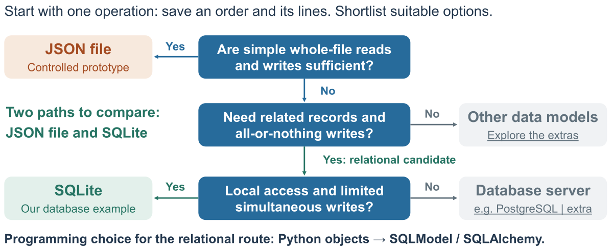
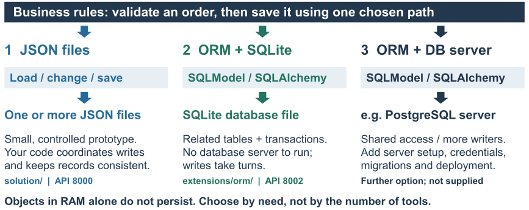

# Choosing storage for our bar example

[Repository overview](../README.md#current-class-persistence-and-databases-exercise-4) | [Exercise 4, Part B](../exercises/04-persistence.md#part-b---explain-json-storage) | [Project choice](../exercises/04-persistence.md#apply-the-comparison-to-your-project)

Start with one operation: **save an order and its lines**. This is the diagram from the classroom slides. It helps shortlist options; the questions are not an exhaustive database-selection algorithm.



## Read the decisions

| Question | What the branch means for our example |
| --- | --- |
| Are simple whole-file reads and writes sufficient? | A JSON file can suit a small, controlled prototype. Our `solution/` loads the file, checks and changes the data, then saves it. The application remains responsible for consistency and coordinating writes. |
| Are related records and all-or-nothing writes central? | A relational database is a useful candidate for orders, order lines and menu items. Relationships and transactions are also available in other database models; this branch is a shortlist, not an exclusive capability claim. |
| Is access local, with limited simultaneous writes? | File-backed SQLite suits our classroom comparison. It permits multiple readers but serialises writes. Evaluate a database server, such as PostgreSQL, when shared service access or greater simultaneous write demand is important. User count alone is not the deciding factor. |
| Does another access pattern dominate? | Explore document, key-value, graph or specialised stores. One application may use more than one store. These are further reading, with no additional setup task in this class. |

The initial JSON prototype and the SQLite comparison illustrate different requirements for the same bar scenario. A JSON file remains a valid project choice when it meets your needs. JSON sent over HTTP is a separate issue: an API can return JSON regardless of how it stores its data.

## Implementations for your project

Use the storage-choice guide above to compare these implementation paths. **Choose the simplest approach that meets your requirements. More tools do not imply a better project.**



| Path | What your code does | Setup and trade-off | Station Bar reference |
| --- | --- | --- | --- |
| JSON files | Load records, validate, modify and save one or more files. | Small, controlled prototype; your code must coordinate writes and consistency across records/files. | `solution/`, API port **8000**. The connected frontend examples use this version. |
| ORM + SQLite | Use mapped SQLModel classes and a session to query/update related rows and commit a transaction. | Local database file, no separate database server. Multiple readers are possible; writes take turns. | `extensions/orm/`, API port **8002**; a smaller comparison with its own data and setup. |
| ORM + database server | Use the ORM with a server such as PostgreSQL. | Useful when shared access or concurrent writes justify extra configuration. Plan the driver, database service, credentials, migrations and deployment; test the behaviour. | A further option, **not a supplied runnable variant**. It does not automatically replace the existing backend. |

Objects, lists and dictionaries in RAM alone do not survive an application restart. Declaring classes is not itself an ORM or a persistence strategy. An in-memory SQLite database is a real database, but is also temporary; our example instead writes to a file. JSON over HTTP remains independent of the chosen storage.

## Inspect SQLite in VS Code or Codespaces

This is optional for projects choosing SQLite. The viewer lets you browse saved tables while you perform operations through the API; it does not replace Swagger or your API's business rules. You do not need to write SQL for this check.

1. Start the ORM example using [its separate virtual environment and Python](../extensions/orm/README.md). Starting it creates the database if it does not exist. Forward API port **8002** and open `/docs`.
2. In the VS Code **Extensions** view (including browser Codespaces), search for **SQLite Viewer by qwtel**, extension ID `qwtel.sqlite-viewer`, and install it. The free read-only view is sufficient. It is not preinstalled by the current Station Bar configuration.
3. In Explorer, open `extensions/orm/data/bar.sqlite`. If required, choose **Open With > SQLite Viewer**. If you configured `BAR_ORM_DB`, open that file instead.
4. Select `menu_item`, `bar_order` or `order_line`. For a small check, use the API to change a menu item's availability. **Refresh or reopen the viewer after the write**, because it caches rows. Compare the stored value with a new API response. Do not edit data directly in the viewer for this exercise.
5. For an order, match the ID returned by the API to `bar_order.id` and `order_line.order_id`. Two coffees in one line mean **one order row and one order-line row with quantity 2**. Do not assume a particular next ID.

The [publisher's demonstration animation](https://raw.githubusercontent.com/qwtel/sqlite-viewer-vscode/master/documentation/demo.gif) shows the interface using Northwind data, not Station Bar. Our tables have different names. This is a table browser, not an H2 SQL console or a SQLAlchemy feature. It requires no additional forwarded database port and does not inspect JSON files or PostgreSQL.

### Include the viewer in your own repository

If your team chooses SQLite, you can add the viewer to `.devcontainer/devcontainer.json` so it is included when your development container is created. **Merge the extension ID into the existing `customizations.vscode.extensions` list; keep all other extensions and settings.** This is a configuration fragment, not a replacement for the full file:

```json
{
  "customizations": {
    "vscode": {
      "extensions": [
        "ms-python.python",
        "qwtel.sqlite-viewer"
      ]
    }
  }
}
```

Commit the configuration in your own repository if you want teammates to receive it. New Codespaces use it; in an existing Codespace, installing the extension manually works immediately. To apply changed container configuration, first save/commit your work and pull the update, then use **Codespaces: Rebuild Container** when needed. This config does not install ORM Python packages; follow the ORM setup guide separately. Do not commit a database containing private data.

References: [SQLite Viewer installation](https://marketplace.visualstudio.com/items?itemName=qwtel.sqlite-viewer), [VS Code: managing container extensions](https://code.visualstudio.com/docs/devcontainers/containers#_managing-extensions).

## Where the ORM fits

**Python objects -> SQLModel / SQLAlchemy -> relational database.** The ORM maps objects to rows and translates operations into SQL. It is a programming approach, not another database family. Our small comparison uses SQLite in a file; declaring a Python class alone does not create an ORM mapping or a database.

In class, first follow the JSON explanation in [Part B](../exercises/04-persistence.md#part-b---explain-json-storage), then sketch related records in [Part C](../exercises/04-persistence.md#part-c---sketch-related-records). We introduce the session and read mapped code before starting the [ORM comparison in Part D](../extensions/orm/README.md#classroom-stages).

## Use it for your project

Choose one operation, state what must be stored and what must succeed or fail together, then justify a storage candidate. Explain one limitation and show evidence that the chosen approach works. Use the [project comparison activity](../exercises/04-persistence.md#apply-the-comparison-to-your-project) after the query experiment. Adopting an ORM is optional; no new project requirement is introduced here.

## Sources and further reading

The decision questions are a teaching synthesis for this repository. The question-and-branch layout is inspired by [Microsoft's vector-search flowchart](https://learn.microsoft.com/en-us/azure/architecture/guide/technology-choices/images/vector-search-flowchart.svg); its product-selection rules are not used here.

- [Microsoft: understand data-store models](https://learn.microsoft.com/en-us/azure/architecture/data-guide/technology-choices/understand-data-store-models) explains relational, document, key-value, graph and other models for different access patterns.
- [SQLite: appropriate uses](https://www.sqlite.org/whentouse.html) discusses local storage, deployment and write-concurrency considerations.
- [FastAPI: SQL databases](https://fastapi.tiangolo.com/tutorial/sql-databases/) supplies the official SQLModel/SQLite teaching example behind our ORM walkthrough.

[Return to Exercise 4](../exercises/04-persistence.md) | [Return to the repository overview](../README.md)
