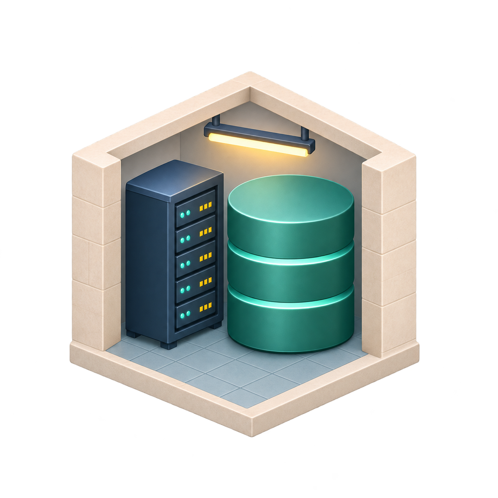

# Exercise 6 — Login, roles and a protected action

[Setup and code map](../extensions/security/README.md) · [Illustrated integration walkthrough](../docs/security/add-login-to-your-project.md)

<!-- login-route:start -->

**Your route through the example**

<table>
<tr>
<td align="center" width="25%"><a href="../docs/security/add-login-to-your-project.md#try-the-roles"><br><strong>1. Try the roles</strong></a><br>Annex A2–A5</td>
<td align="center" width="25%"><a href="../docs/security/add-login-to-your-project.md#trace-the-checks"><br><strong>2. Trace the checks</strong></a><br>Annex A6–A13</td>
<td align="center" width="25%"><a href="../docs/security/add-login-to-your-project.md#protect-your-action"><br><strong>3. Protect your action</strong></a><br>Annex A14–A16</td>
<td align="center" width="25%"><a href="../docs/security/add-login-to-your-project.md#verify-the-result"><br><strong>4. Verify the result</strong></a><br>Annex A17–A18</td>
</tr>
</table>

The four stages match the **08A FastAPI Login and Permissions** slides. Start with the working example; use the later stages when adapting your project.

**Considering an external provider?** [Choose the Auth0 or Keycloak route](../docs/security/add-login-to-your-project.md#login-options); optional guided configurations in A21–A22.

<!-- login-route:end -->

**Goal:** follow one action from a signed-in identity through a server-side permission check to saved data.

1. From the repo root run **`python start_security.py`** and open **8003 /login**. Read the fictional passwords in `.classroom/security-credentials.json` locally.
2. Sign in as **user**. Browse the menu. Open **/admin** directly: expect **403**. Explain why a hidden button alone would not be enough.
3. Sign out, sign in as **admin**, and open **Admin area**. Read the account/role table. Add `Workshop tea`, price `4.00`.
4. Inspect **`extensions/security/data/menu.json`**. Sign back in as **user** and find the new item. The menu is shared; permission to change it differs.
5. In **`extensions/security/accounts.py`**, find `ROLE_PERMISSIONS`. In **`pages.py`**, trace `browser_user()` → `can_manage_menu()` → `add_menu_item()`. Which function prevents the write?

**Stop and discuss:** show the two views, one allowed operation and one denied attempt. Explain where the role is assigned and where it is enforced. Screenshots must not include passwords, session cookies or API tokens.

## Optional: compare API credentials

Open `/docs` on port8003. Repeat the same `POST /menu-items` with no bearer token (401), the `user` token (403), and the `admin` token (201). Copy the **token**, not the password, from the local credentials file into **Authorize**. Use **Logout** before switching. A browser login does not automatically sign you into this separate bearer API path.

```json
{"name": "Workshop coffee", "price": 4.5, "currency": "CHF", "available": true}
```

Rejected requests leave the saved JSON unchanged. `python start_security.py --check` reproduces checks using temporary data.

## Continue in your own project

Use the [step-by-step walkthrough](../docs/security/add-login-to-your-project.md) and the separate FastAPI implementation deck. Protect one meaningful operation using your existing backend, data store and README. The sample Jinja route is one implementation option; external identity providers and separate JavaScript clients need their corresponding integration. Full coaching and submission requirements remain in Moodle.
