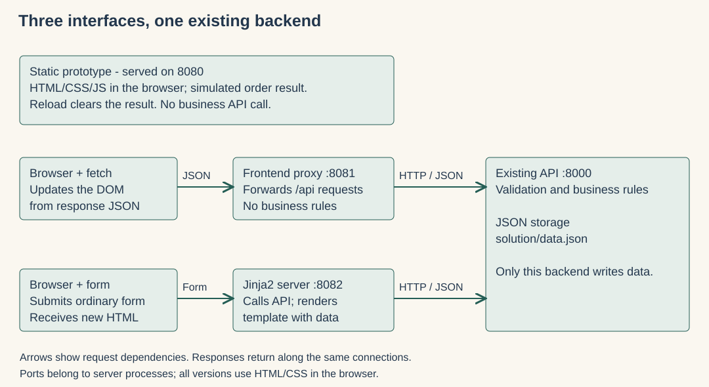
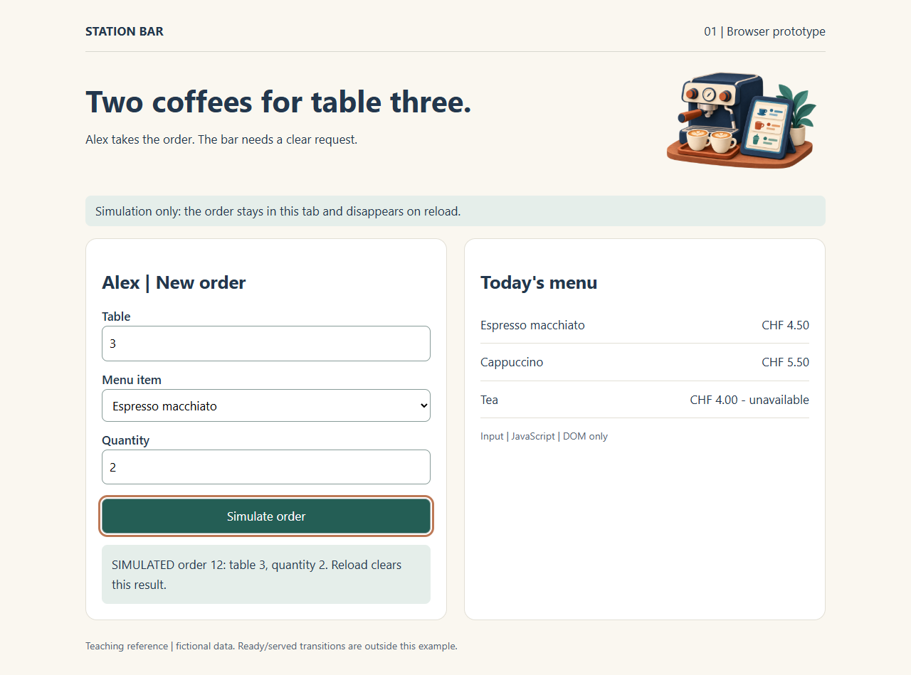
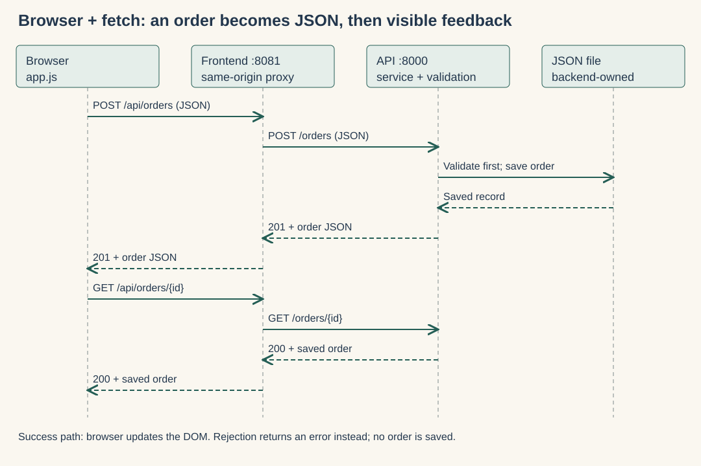
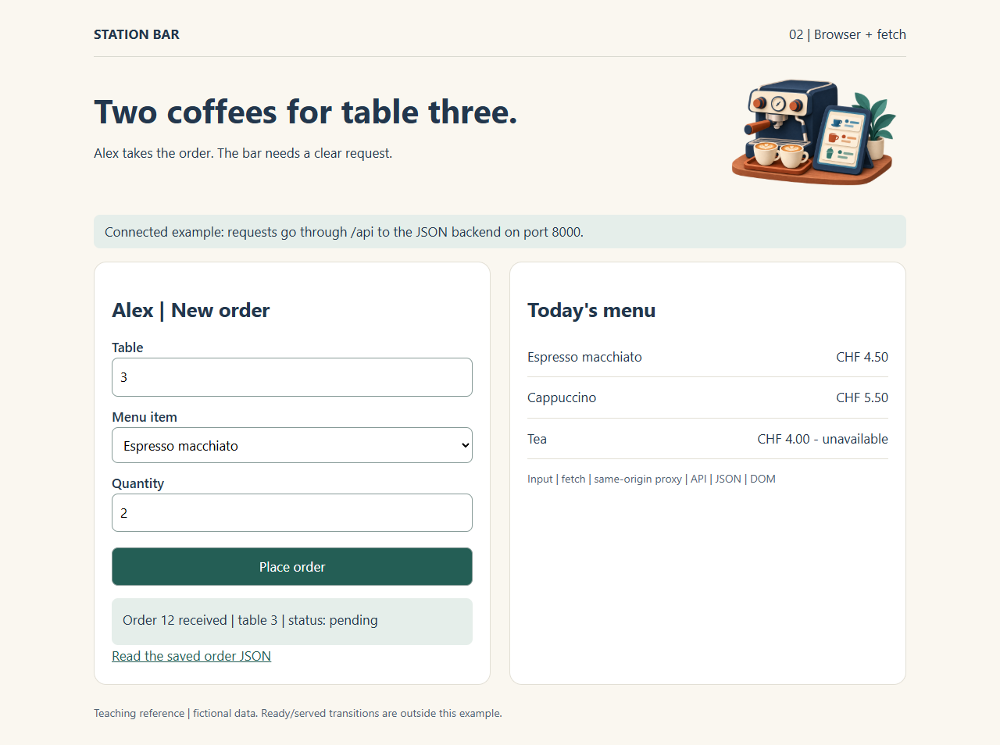
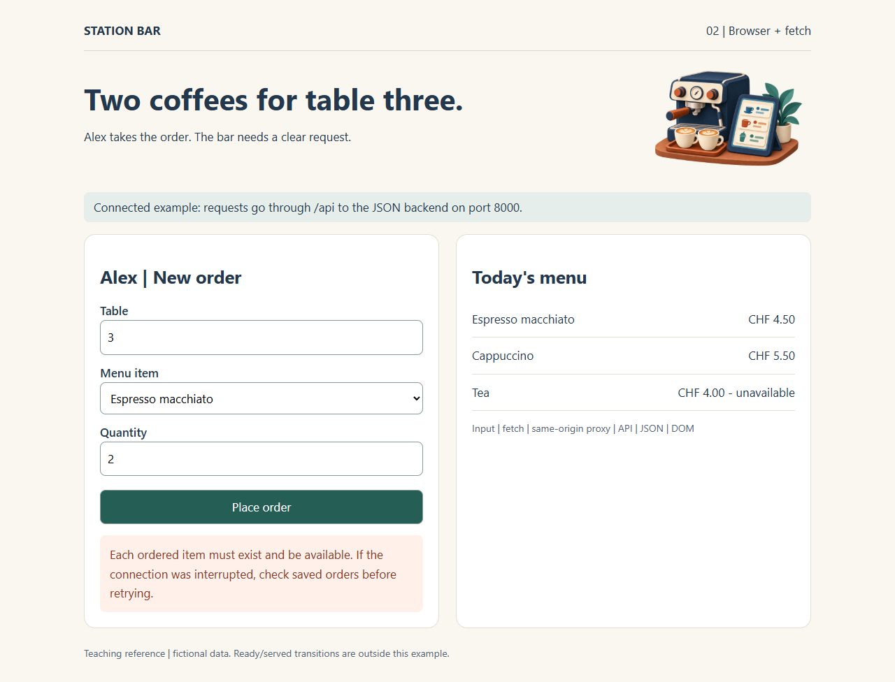
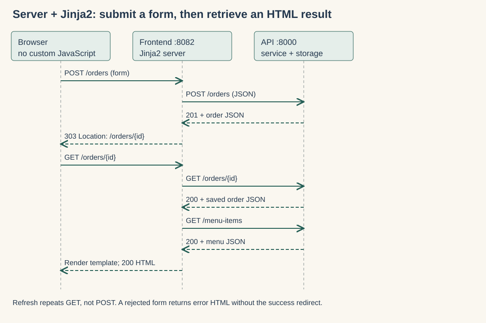
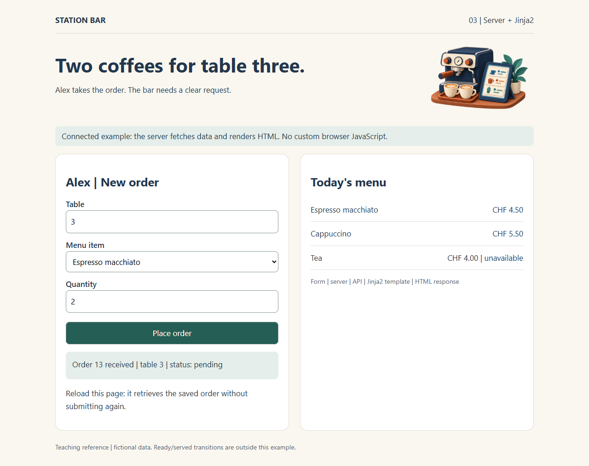

# Frontend examples: from our sketch to a saved order

The same Station Bar order form is implemented three ways. Start with the earlier design: Alex enters table, menu item and quantity; the interface confirms the result or explains a rejection. The existing JSON API is still the only owner of business rules and saved orders.

This is the walkthrough for **[Exercise 5](../../exercises/05-frontend.md)**. In class, we compare selected interfaces and discuss which route fits your project. Setup and extension instructions are available for independent follow-up; there is no timed classroom coding task. Reuse any setup you have already completed.

[Setup](#1-update-and-prepare-once) | [Run](#2-run-one-example-at-a-time) | [Inspect](#3-observe-inspect-then-stop) | [Extend](#4-extend-one-small-part) | [Coaching](#5-prepare-for-coaching)

## Quick start for this class

From the repository root, run `python start_class.py` once, then use its labelled browser links. It prepares the separate environments and starts the SQLite recap, JSON API, all three interfaces and styling comparison. Keep the terminal open; stop with Ctrl+C. For just the frontend examples, use `python start_class.py --only frontend`. **[Class startup and SQLite inspection](../../docs/class-start.md)** explains ports and troubleshooting.

The numbered setup/run sections below are the **manual alternative**; you do not need to run those commands as well.

## What this teaching update adds

| Example | Port | Start reading | Where the result is produced |
|---|---:|---|---|
| [Static browser prototype](static/index.html) | 8080 | `static/index.html`, then `static/app.js` | JavaScript updates this browser tab. IDs are simulated; reload clears the result. |
| [Browser API client](api-client/index.html) | 8081 | `api-client/app.js`: `request()` and submit handler | `fetch` receives JSON and changes the DOM. A same-origin proxy forwards to the API. |
| [Server-rendered Jinja2](server-rendered/templates/index.html) | 8082 | Template plus `app_server.py`: `create_order()` and `page()` | Server calls the API and combines data with HTML; ordinary form submission navigates to a new page. |

The table links open **source files**, not live previews on GitHub. Start the servers below to use the interfaces.

[](shared/diagrams/frontend-components.svg)

`shared/theme.css` and `shared/assets/` give all versions the same visual identity. `app_server.py` contains small presentation adapters; it never opens the backend data file. The existing `solution/`, `starter/` and optional ORM example remain available. Ready/served actions from the earlier clickable prototype are not implemented by these examples.

## Prepared styling comparison: custom CSS and Bootstrap

[Open the guide and files](style-comparison/README.md) to compare two ready versions of the same static order form. The desktop and mobile screenshots come from those files. Both share the same JavaScript and fictional menu; only their layout and control styling differ.

For a downloaded copy, open `style-comparison/index.html` in a browser after extracting all files. Bootstrap CSS is included locally, so the comparison works offline and needs no API or package installation. On GitHub, the HTML link shows source; the class launcher starts its Codespaces preview on port **8090**. The guide retains the standalone command. The three rendering examples below remain the main Exercise 5 walkthrough.

## 1. Update and prepare once

Reopening a Codespace does not pull teaching changes. Follow [updating your Codespace](../../docs/updating-your-codespace.md), protecting your own work first. Fork the repository for your own changes; use a branch for the frontend exercise.

Run all commands below **from the repository root** (the folder containing `run.py`). Use an isolated environment; optional frontend packages are not installed by the base Dockerfile.

**Codespaces / Linux / macOS:**

```sh
python -m venv .venv-frontend
.venv-frontend/bin/python -m pip install -r extensions/frontend/requirements.txt
```

**Windows PowerShell:**

```powershell
python -m venv .venv-frontend
.venv-frontend/Scripts/python.exe -m pip install -r extensions/frontend/requirements.txt
```

Use that environment's Python in every terminal. Activation is optional. The screenshots use the initial fictional seed data; your IDs and availability can differ.

## 2. Run one example at a time

For the static prototype, no backend is needed:

```sh
.venv-frontend/bin/python extensions/frontend/run.py static --host 0.0.0.0
```

For either connected version, start the API in terminal 1:

```sh
.venv-frontend/bin/python run.py solution --port 8000 --host 0.0.0.0
```

Then choose one interface in terminal 2:

```sh
.venv-frontend/bin/python extensions/frontend/run.py api-client --host 0.0.0.0
# OR, after stopping it with Ctrl+C:
.venv-frontend/bin/python extensions/frontend/run.py server-rendered --host 0.0.0.0
```

On Windows replace `.venv-frontend/bin/python` with `.venv-frontend/Scripts/python.exe`. On your own machine you can omit `--host 0.0.0.0` to use the local-only default. Open `http://127.0.0.1:8080`, `:8081` or `:8082` locally.

In Codespaces open the **Ports** tab and use **Open in Browser** for the chosen frontend port. Keep ports private; sign in if asked. If your existing Codespace has not picked up the new forwarding configuration, manually forward 8080/8081/8082. Do not type localhost into a browser on your own computer to reach a remote Codespace. The API and frontend processes run inside the same Codespace, so their internal connection is `http://127.0.0.1:8000`. No public API URL is needed.

### Codespaces: which preview do I open?

| What you want to inspect | How to open it |
|---|---|
| This guide and its UML-style diagrams | Open this README in the Codespaces editor, then choose **Markdown: Open Preview to the Side** from the Command Palette. Expand the screenshot sections when needed. |
| The working interface | Keep the server terminal running. In **Ports**, open **8080**, **8081** or **8082** in your browser, matching the variant you started. Opening `index.html` in the editor only shows its source. |
| Backend Swagger for the rejection experiment | Open **8000** from **Ports**, then append `/docs` to that forwarded browser URL. Keep this port private too. |

The browser uses a forwarded **HTTPS** address; the frontend server uses **HTTP localhost inside the Codespace** to reach the API. Leave `--api-url` at its default. The fetch example uses relative `/api/...` URLs, and Jinja2 uses relative form/redirect paths, so neither needs your personal Codespace address pasted into the code.

If something does not open, first check that the matching terminal is still running and the port is listed. If the interface opens but reports the API unavailable, check terminal 1 and port 8000. If a Python package is missing, repeat the installation above and use `.venv-frontend/bin/python` in **both** terminals; the default Codespaces interpreter does not automatically use this optional environment. Reopening a stopped Codespace requires starting the servers again.

Stop each process with Ctrl+C. Restarting a process does not delete `solution/data.json`. Do not reset it just to reproduce screenshot IDs. Run only one backend process against that JSON file.

## 3. Observe, inspect, then stop

### Browser prototype

Submit an order, inspect `orderInput()` and the submit handler, then reload. There is no API `POST /orders`; the local menu JSON file is only sample content. **Stop:** explain why the visible confirmation is not evidence of persistence.

<details>
<summary>Screenshot: static prototype (click to expand)</summary>

<a href="shared/screenshots/01-static.png"></a>

</details>

### Browser + fetch

Open browser DevTools -> Network **before** submitting. Inspect `POST /api/orders`: method, JSON payload, status and response. Click **Read the saved order JSON**. Record its ID. Reload the interface: its message resets, but retrieving that order still works.

Trace `api-client/app.js` -> `app_server.py` proxy -> existing API on 8000 -> service/storage -> JSON -> DOM. The proxy does not implement business rules. These are two HTTP hops; Network shows the browser hop. It is not a direct cross-origin call. A direct browser call to a different origin would require an intentional CORS setup; do not use `no-cors` as a fix.

[](shared/diagrams/fetch-sequence.svg)

Read top to bottom. Solid arrows are requests/calls; dashed arrows are returns. The optional readback at the end verifies the saved record. This is a simplified sequence, not a class diagram.

<details>
<summary>Screenshot: api confirmation (click to expand)</summary>

<a href="shared/screenshots/02-api-client.png"></a>

</details>

**Rejection experiment:** load the menu, then temporarily mark the selected item unavailable through the backend Swagger UI (`/docs` on 8000). Submit the already-selected item. Observe the error and verify no order was created; restore availability afterwards. Use fictional data. If an API connection fails during a write, check saved orders before retrying: a lost response does not prove the write failed.

<details>
<summary>Screenshot: api rejection (click to expand)</summary>

<a href="shared/screenshots/04-api-rejection.png"></a>

</details>

**Stop:** explain the roles of `try`, `catch` and `finally`, and which layer rejected the order.

### Server + Jinja2

Submit the same order. In Network inspect a **document/form** request to `/orders`, a 303 redirect, and a GET to `/orders/{id}` returning HTML. Use View Source to see menu content already in the response. This example works with JavaScript disabled. Refreshing the confirmation retrieves the saved order; it does not submit the form again (Post/Redirect/Get).

The server makes an HTTP call to the same backend for a fair comparison. Another valid architecture is a server template and API sharing an in-process service; we do not need a second data store here.

[](shared/diagrams/jinja-sequence.svg)

The browser receives HTML; the server receives JSON from the API. The redirect separates creating the order from displaying it.

<details>
<summary>Screenshot: server-rendered confirmation (click to expand)</summary>

<a href="shared/screenshots/03-jinja2.png"></a>

</details>

**Stop:** identify `{{ ... }}` values and `` iteration in the template. Compare with Thymeleaf's `th:text` / `th:each`. Explain where JSON becomes HTML.

[View the narrow-screen example](shared/screenshots/05-mobile.png). Use browser resizing to compare with the responsive-layout sketches from the design class.

## 4. Extend one small part

**Optional independent practice, not an additional required task.** Keep the working baseline. One possible extension is a **client-side menu-name filter** in the API-client variant. Keep ordering and backend rules unchanged. Review the diff, try a match and no matches, then repeat an order success and rejection. The unmodified example is the fallback.

Suggested assistant prompt:

> Read extensions/frontend/api-client and the shared theme. Add a labelled menu-name filter to the displayed menu list. Keep the original menu data and order-selection control intact. Do not change the backend or dependencies. Explain each changed function and how to check matching, empty results and clearing the filter. Then explain how to repeat the existing success/rejection checks.

For your own extension, an order lookup is another bounded option. Choose one approach; implementing all three is not required. Your existing project may use a different tool if you can explain and verify it.

## 5. Prepare for coaching

Update **your own project's existing README** with one current workflow, setup, evidence, limitations and questions. Follow Moodle for the full coaching instructions, submission deadline and your Teams slot. Do not create another report or copy this reference app's claims into your project.

## How the slide annexes relate to these files

The main lecture compares the three runnable examples above. **Annex A (Static pages, API calls and Jinja)** explains how to adapt a static export and reuse templates. The supplied Jinja version uses custom CSS and one template; the Bootstrap-to-Jinja conversion and base-layout refactor are optional adaptations, not extra installed variants. **Annex B (Alternative frontend routes)** illustrates components, Python UI, Budibase and generated interfaces. Those tools are not installed here; discuss a relevant route during coaching. The annexes are optional implementation references, not additional exam material.

## References and limits

- [FastAPI templates / Jinja2](https://fastapi.tiangolo.com/advanced/templates/)
- [MDN fetch](https://developer.mozilla.org/en-US/docs/Web/API/Fetch_API/Using_Fetch)
- [FastAPI CORS](https://fastapi.tiangolo.com/tutorial/cors/)

These are small teaching examples, not production systems: no authentication, payment or concurrent multi-process JSON storage. Local HTTP and browser checks cover the examples; hosted private-port authentication still needs a Codespaces rehearsal. Screenshots show actual local runs with temporary fictional data, not a hosted deployment.
