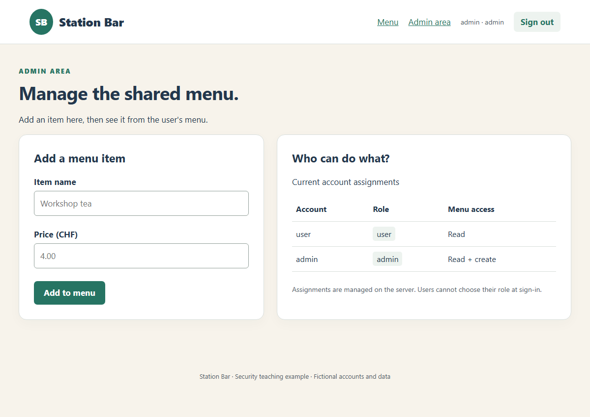

# Security: sign in as a user or an admin

[Repository overview](../../README.md) · [Exercise 6](../../exercises/06-security.md) · [Add login to your project](../../docs/security/add-login-to-your-project.md)

<!-- login-route:start -->

**Your route through the example**

<table>
<tr>
<td align="center" width="25%"><a href="../../docs/security/add-login-to-your-project.md#try-the-roles"><br><strong>1. Try the roles</strong></a><br>Annex A2–A5</td>
<td align="center" width="25%"><a href="../../docs/security/add-login-to-your-project.md#trace-the-checks"><br><strong>2. Trace the checks</strong></a><br>Annex A6–A13</td>
<td align="center" width="25%"><a href="../../docs/security/add-login-to-your-project.md#protect-your-action"><br><strong>3. Protect your action</strong></a><br>Annex A14–A16</td>
<td align="center" width="25%"><a href="../../docs/security/add-login-to-your-project.md#verify-the-result"><br><strong>4. Verify the result</strong></a><br>Annex A17–A18</td>
</tr>
</table>

The four stages match the **08A FastAPI Login and Permissions** slides. Start with the working example; use the later stages when adapting your project.

**Considering an external provider?** [Choose the Auth0 or Keycloak route](../../docs/security/add-login-to-your-project.md#login-options); optional guided configurations in A21–A22.

**Want to implement JWT access?** [Run the optional JWT practice](../../docs/security/jwt-practice.md); same accounts and action, A23–A26.

<!-- login-route:end -->

The example now includes **a login page, a user menu and an admin area**. Both identities see the same saved menu; only the admin can add items. The admin page also shows the current role assignments. A direct request to an admin route is rejected for a user even when it bypasses the interface.



## One command

After [updating your Codespace safely](../../docs/updating-your-codespace.md), run this from the repository root:

```sh
python start_security.py
```

Or choose **Terminal → Run Task → Station Bar: security lesson**. The launcher prepares `.venv-security` and starts port **8003**. Open the printed **/login** link. First setup needs package-download access; system Python and the earlier example environments are unchanged.

Open **`.classroom/security-credentials.json` in the editor** for the fictional `user` and `admin` passwords. Sign in as `user`, browse the menu, then try `/admin`. Sign out and sign in as `admin`, open **Admin area**, add an item, and view the updated menu. For simultaneous views use separate browser profiles; ordinary tabs share a login cookie. Keep real and demo credentials out of Git, screenshots and messages.

In Codespaces keep port **8003 Private**. If needed, use **Ports → Add Port → 8003**; forwarding alone does not start the server. Keep the terminal open; **Ctrl+C stops this run**. `python start_security.py --setup-only` prepares dependencies ahead of class.

## What is saved, and where?

| File/state | Purpose | On restart |
|---|---|---|
| `extensions/security/data/menu.json` | Separate menu data using the existing JSON store | Kept |
| `.classroom/security-accounts.json` | Fictional usernames, assigned roles and Argon2 password hashes | Kept |
| `.classroom/security-credentials.json` | Local teaching access sheet: generated passwords and optional API tokens | Passwords kept; API tokens rotated |
| Browser sessions in server memory | Resolve the random cookie identifier to the signed-in account | Everyone signs out |

These local data/credential files are Git-ignored and are not served over HTTP. The teaching access sheet necessarily contains readable demo passwords; the login verifier uses the separate hashes. If the sheet is lost, no plaintext password can be recovered from its hash. For a fresh fictional setup, stop the example, rename **both** account/credential files as local backups and restart. The launcher does not reset the menu.

## Where are permissions set?

| Role | Browse menu | Create item |
|---|---|---|
| `user` | Yes | No |
| `admin` | Yes | Yes: `menu:write` |

[`accounts.py`](accounts.py) defines `ROLE_PERMISSIONS`; `Account.role` comes from server-controlled account data. [`pages.py`](pages.py) resolves the session in `browser_user()` and enforces the permission in `can_manage_menu()`. Both the admin page and its POST operation require that dependency. Jinja hides controls for convenience; the server makes the actual access decision. The assignment table is read-only; changing a role is not an action offered to a normal user.

The [illustrated integration walkthrough](../../docs/security/add-login-to-your-project.md) gives the sequence, functions, files, adaptation steps and checks. It follows the Jinja route from the previous class. The separate **08A FastAPI Login and Permissions** slide deck follows the same sequence; the main lecture presents the concepts and visible outcomes.

## Optional API comparison

Open **/docs** on the same port for the earlier bearer-token checks. Public `GET /menu-items` needs no login. For `POST /menu-items`, no token gives **401**, the `user` token gives **403**, and the `admin` token gives **201**. Paste only the account's **token value** into Swagger **Authorize**, and use **Logout** before switching credentials. `GET /whoami` shows its verified identity.

Browser cookies and API bearer tokens are deliberately separate here. Signing in on the page does not authorise Swagger. Both paths enforce `menu:write` and reuse the same business service/data; no unprotected alternative write route is mounted. The opaque API tokens expire after four hours. Browser sessions expire after one hour, rotate on login and are revoked on logout. The default mode uses opaque tokens. Optional JWT routes are enabled below; this example is not an OAuth/OIDC provider.

```sh
python start_security.py --check
```

Checks use temporary data. They verify login, permissions, CSRF, logout, expiry, rejection without writes, safe rendering and the API comparison.

## Optional JWT implementation

Stop the current security launcher first, then run:

```sh
python start_security.py --jwt
```

On the same private port **8003 /docs**, use **POST /jwt/token** with your local user/admin password, then paste the returned **access_token** into **Authorize > JWT access token (optional)**. Use **GET /jwt/whoami** and **POST /jwt/menu-items**. The original opaque-token field is for the routes without `/jwt`.

[Follow the JWT practice guide](../../docs/security/jwt-practice.md), matching annex **A23-A26**, for the exact steps, code functions, permitted/denied outcomes and project adaptation. `jwt_api.py` implements issuance, verification and current-account permission checks. `requirements-jwt.txt` adds PyJWT only to the isolated security environment when requested.

JWTs expire after five minutes. Their random in-memory signing key changes on restart, invalidating existing JWTs; passwords and menu data remain. Browser logout does not revoke a JWT. No refresh-token or individual-token revocation flow is implemented. This local JSON credential exchange is not OAuth delegated access.

Run **`python start_security.py --jwt --check`** for the existing checks plus the JWT checks, using temporary data.

## Adapting it

Follow [Add login to your project](../../docs/security/add-login-to-your-project.md), using your existing user store, service and README. The example has a single-process session store and fictional seeded accounts; registration, recovery and public deployment need additional decisions. For customer-owned records, add a trusted ownership relationship and check the specific object.

The earlier API on 8000, ORM example and frontend variants remain separate and unchanged. Starting this demo does not secure them. When integrating your own app, protect every route reaching the same operation/data.

Start with the [FastAPI password-hashing example](https://fastapi.tiangolo.com/tutorial/security/oauth2-jwt/) and [templates guide](https://fastapi.tiangolo.com/advanced/templates/), then keep [OWASP session management](https://cheatsheetseries.owasp.org/cheatsheets/Session_Management_Cheat_Sheet.html) and [CSRF prevention](https://cheatsheetseries.owasp.org/cheatsheets/Cross-Site_Request_Forgery_Prevention_Cheat_Sheet.html) alongside the implementation. The FastAPI JWT example is an alternative token flow, not an exact description of our browser sessions.
